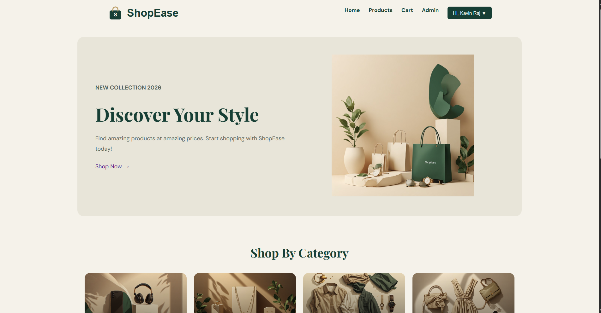
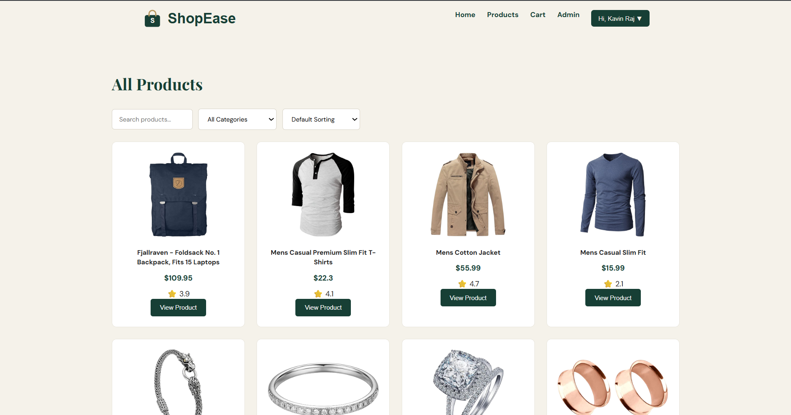
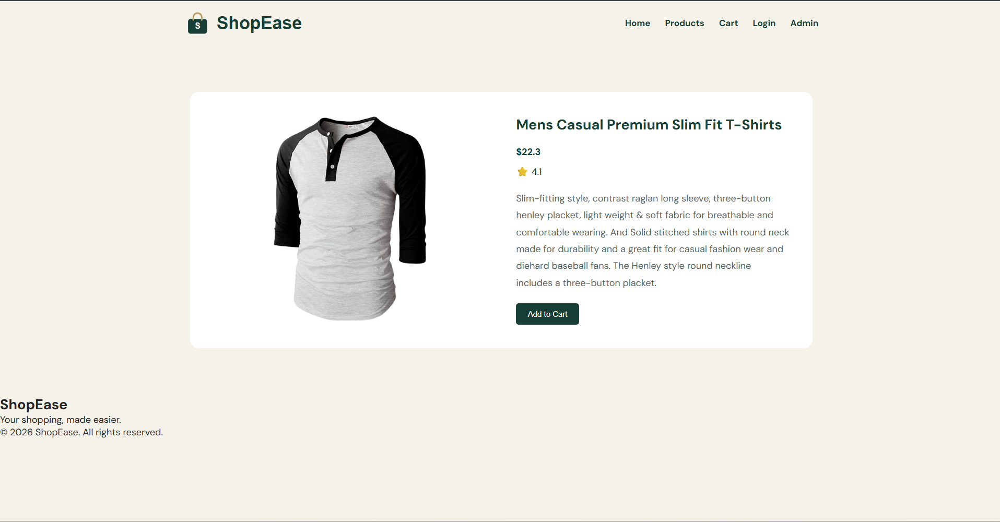
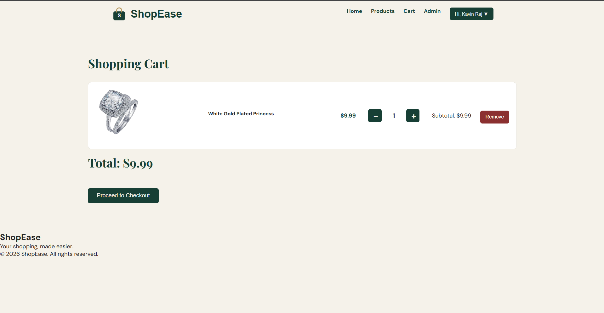
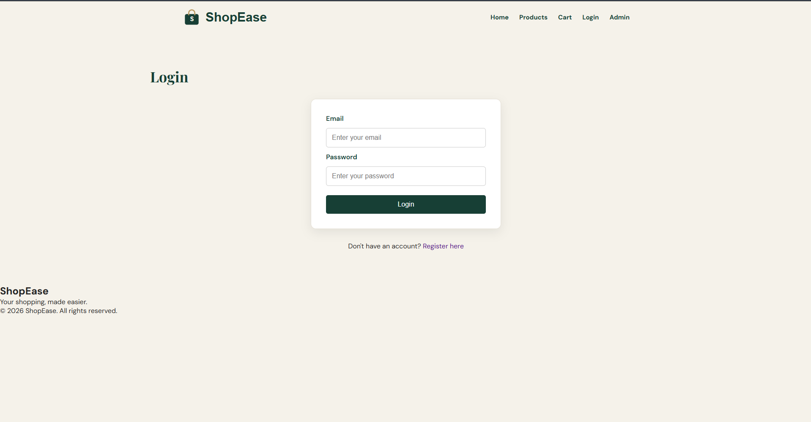
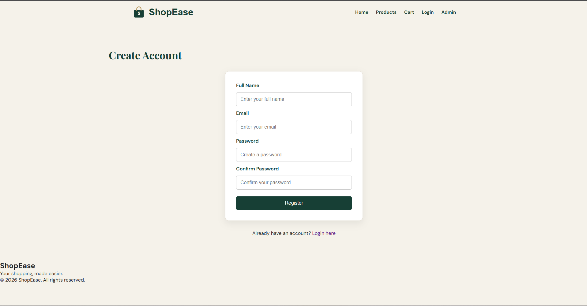
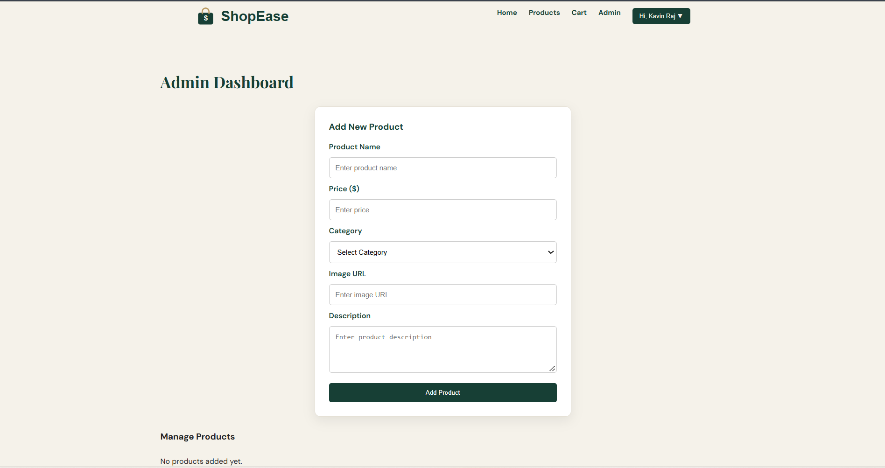
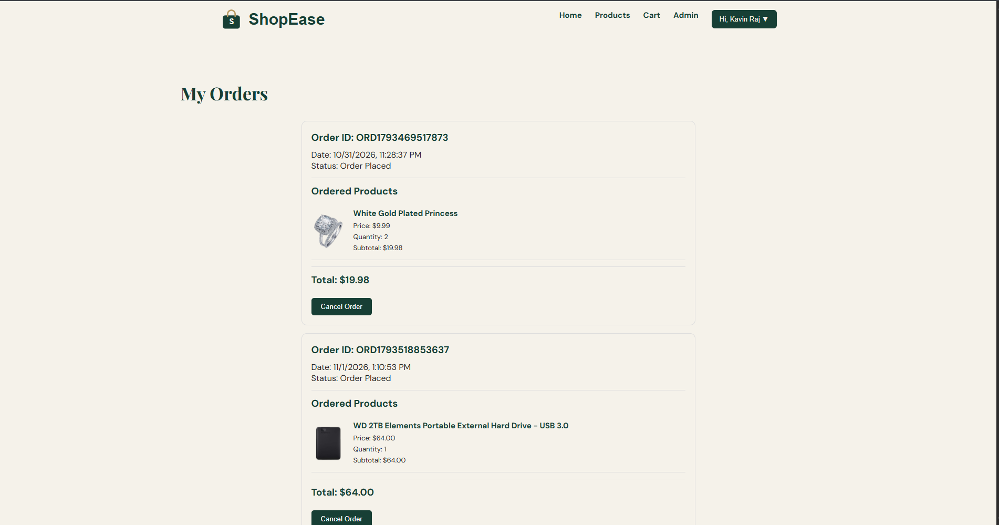

# ShopEase – E-Commerce Storefront
## Live Demo

[Visit ShopEase](https://bhavansenthilkumar-a11y.github.io/ShopEase/)
ShopEase is a responsive e-commerce storefront developed using HTML, CSS, and JavaScript. It allows users to browse products, search and filter items, manage their shopping cart, place orders, and track their order history.

## Features

### User Features
- Responsive homepage with product categories and featured products.
- Browse products fetched from the FakeStore API.
- Search products by name.
- Filter products by category.
- Sort products by price (Low to High and High to Low).
- View individual product details.
- User registration and login.
- Add products to the shopping cart.
- Increase or decrease product quantities.
- Remove products from the cart.
- Place orders through checkout.
- View order history.
- Cancel placed orders.
- Profile dropdown with logout functionality.

### Admin Features
- Add new products.
- View added products.
- Edit existing products.
- Delete products.
- Display admin-added products on the products page.

## Technologies Used

- **HTML5** – Structure of the application.
- **CSS3** – Styling and responsive design.
- **JavaScript** – Application logic and interactive functionality.
- **FakeStore API** – Fetching product data.
- **LocalStorage** – Storing user information, cart items, admin products, and orders.

## Project Structure

ShopEase/
│
├── index.html
├── login.html
├── register.html
├── products.html
├── product-details.html
├── cart.html
├── admin.html
├── orders.html
│
├── css/
│   ├── style.css
│   └── responsive.css
│
├── js/
│   ├── app.js
│   ├── auth.js
│   ├── products.js
│   ├── products-page.js
│   ├── product-details.js
│   ├── cart.js
│   ├── admin.js
│   └── orders.js
│
├── assets/
│   ├── images/
│   └── screenshots/
│
└── README.md

## Screenshots

### 1. Homepage

### 2. Products Page

### 3. Product Details

### 4. Shopping Cart

### 5. Login Page

### 6. Register Page

### 7. Admin Dashboard

### 8. My Orders

## How to Run the Project

1. Clone or download this repository.
2. Open the project folder in Visual Studio Code.
3. Open the `index.html` file using the Live Server extension.
4. Browse the ShopEase application.

**Note:** An internet connection is required to fetch product data from the FakeStore API.

## Future Improvements

- Backend integration for secure authentication.
- Database integration for persistent product and order storage.
- Secure admin authentication and authorization.
- Payment gateway integration.
- Improved product recommendations.

## Disclaimer

ShopEase is a learning project developed for educational and internship purposes. Authentication and data storage currently use browser LocalStorage and are not intended for production use.

## Author

Developed as a Front-End E-Commerce Project.
